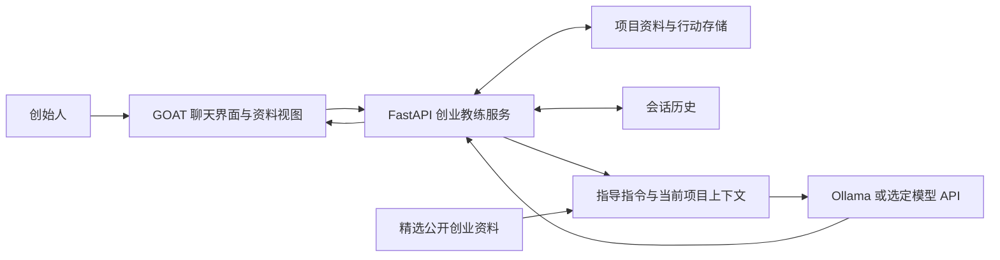

# 第一版原型设计与演示稿

更新日期：2026-10-08。本文保留待老师审阅的设计草稿和手写示例对话，不能把示例当模型输出。对应最小实现已经通过真实本地模型、资料持久化和两会话测试，实际输入/输出见 [运行归档](archive/2026-10-08-goat-reuse.md)。所有创业者与访谈数据均为虚构；自动摘要、资料提取和专家质量认可尚未完成。

## 1. 用户与核心场景

用户：一个希望推出校园晚餐配送服务的学生创始人。

当前情况：有想法，没有完成客户需求验证。希望判断先服务谁、验证什么、如何开展第一轮访谈。

第一版要回答的问题：用户下一次回来时，教练能否记住上次约定的行动，准确理解实际结果，并给出适应新证据的下一步？

## 2. 用户流程草稿（W1）

| 步骤 | 用户行为 | 教练行为 | 项目状态 |
| --- | --- | --- | --- |
| 初次进入 | 说明想法、对象和困难 | 了解项目与创始人背景，询问缺失信息 | 建立 venture_id 和初始 profile |
| 澄清 | 说明客户、现有替代方案、已有证据 | 追问真实经历，区分想法与观察 | 登记假设和证据 |
| 提出行动 | 确认愿意做的验证任务 | 给出具体、有限、可执行的行动 | 保存已同意的 action plan |
| 结束会话 | 检查摘要 | 汇总已知、未知和下次跟进点 | 保存摘要并提供纠正方式 |
| 返回项目 | 打开同一项目的新会话，报告进展 | 读取项目资料与上次行动，询问执行结果 | 区分计划数量与实际数量 |
| 复盘 | 说明新发现 | 更新证据、假设和下一步建议 | 保留变化原因和仍未验证事项 |

“第二次会话”可发生在另一个 session，但应关联同一个 venture_id。只在原窗口连续聊天无法充分验证跨会话恢复。

## 3. 创业者资料模板（W2）

| 类别 | 字段 | 示例 | 更新方式 |
| --- | --- | --- | --- |
| 身份/关联 | venture_id、session_ids | demo-campus-meals-01 | 由系统建立；新会话关联相同项目 |
| 创始人 | background、constraints、goals | 学生；可投入时间有限；先验证需求 | 用户明确说明或纠正 |
| 项目背景 | description、stage、target_customer | 校园晚餐配送；idea/validation；晚课学生 | 用户确认后更新 |
| 待验证假设 | assumption_id、statement、status | 目标用户愿意为更快配送付费；untested | 证据变化时更新，保留理由 |
| 证据 | evidence_id、observation、sample_size、source | 两次虚构访谈中均提到价格 | 记录样本和来源，不自动泛化 |
| 行动 | action_id、task、planned_count、actual_count、status | 计划访谈 5 人；实际 2 人；partial | 用户反馈及确认 |
| 连续指导 | latest_summary、open_questions、next_step | 价格敏感度仍不清楚 | 会话结束时更新，用户可纠正 |

建议最小状态例子（演示数据，不代表已有 API 契约）：

```json
{
  "venture_id": "demo-campus-meals-01",
  "stage": "validation",
  "description": "校园晚餐配送服务",
  "target_customer": "晚课后需要晚餐的学生",
  "assumptions": [
    {
      "id": "a1",
      "statement": "目标用户愿意为更快配送支付溢价",
      "status": "untested"
    }
  ],
  "actions": [
    {
      "id": "act1",
      "task": "访谈潜在用户，了解近期晚餐经历、替代方案和花费",
      "planned_count": 5,
      "actual_count": 0,
      "status": "planned"
    }
  ],
  "evidence": [],
  "open_questions": ["价格、等待时间和获取方式分别有多重要？"]
}
```

实施原则：模型提出待保存的更新；用户确认/纠正后保存。未知字段留空，不由模型补造。行动状态区分 planned、partial、completed；证据描述区分用户反馈和模型推断。

创业领域状态建议独立保存，并复用 GOAT 的数据库/服务基础。知识库保存可共享的创业材料；项目 profile 保存这个用户的具体背景，两者用途不同。

## 4. 指导框架草稿（W3）

1. 澄清：项目解决谁的什么问题？当前使用什么替代方案？
2. 查证：哪些是创始人的猜测，哪些已有访谈、观察或实验支持？
3. 排序：哪个不确定性会最先影响下一步决策？
4. 行动：提出一个小范围验证任务，说明对象、方式和要记录的结果。
5. 复盘：读取上次任务，确认实际执行情况，再根据结果更新建议。

行为约束：优先问少量关键问题；不急于生成完整商业计划；不把小样本说成市场已验证；不假定行动已完成；当信息不足时解释还缺什么。

这些是团队提出的通用框架，不代表 Ain 已认可其完整 EIR 方法。后续用具体对话向 EIR 求证。

## 5. 两次会话脚本（W4）

### 第一次：明确需要验证什么

创始人：我想给上晚课的学生送晚餐，觉得他们会需要配送更快的服务。

教练：你主要面向哪类学生？你见到过他们最近一次解决晚餐问题的具体经历吗？现在有哪些替代方案？

创始人：主要是晚课学生。我还没有访谈过，只是觉得大家课后很累，外卖等待时间长。

教练：目前“愿意为更快配送付费”仍是假设。建议先访谈 5 位符合目标条件的学生，询问他们最近一次晚课后的晚餐经历、怎么解决、等了多久、花了多少钱，以及最不满意的地方。先记录真实行为，再判断价格、速度和获取方式哪个最重要。你愿意把它作为下一步吗？

创始人：可以，我先做这 5 次访谈。

教练：我会保存目标客户、待验证假设和这项访谈计划。你回来后，我们根据实际结果讨论下一步。

演示操作：显示已保存资料，然后重载页面或打开关联同一项目的新会话。模型的实际回答可不同，但应满足上述行为目标。

### 第二次：使用保存的行动并更新判断

创始人：我这次只访谈了两个人，他们都说价格比速度更重要。

教练：上次我们计划访谈 5 位晚课学生，现在完成了 2 位。这个发现提示价格可能更关键，但还不足以代表所有目标用户。两位分别怎样解决晚餐？实际花费是多少？你能继续完成剩余访谈，并记录价格、等待时间和替代方案吗？

创始人：一位常买便宜快餐，另一位回宿舍吃。之前我确实把速度想得太重要了。

教练：先把“愿意为速度付溢价”记为受到初步挑战，保留样本只有两人的限制。下一轮先补齐访谈，了解能够接受的总价和真实取餐方式，再决定是否测试固定时间取餐或配送。现阶段还不能认定某个方案会更成功。

应保存的变化：actual_count=2、status=partial、新 evidence 两条；原假设变为“初步受挑战”，而非直接判定为假；下一步是补充证据并比较方案。

### 演示失败判据

- 第二次仍要求用户重新介绍整个项目，且没有联系上次任务。
- 把计划 5 次访谈写成已完成 5 次。
- 把两位受访者观点写成全体学生的市场事实。
- 重新建议原先的速度溢价方案而不处理价格新证据。
- 在新会话中靠手工粘贴整段旧对话才能表现出“记忆”。

验收结果填写在 [本周交付清单](WEEKLY_DELIVERABLES.md)，脚本本身不能作为通过证据。

## 6. 最小架构草图（S1）



这是目标架构，不是当前运行状态。已有 GOAT 提供界面、FastAPI、Ollama、历史及知识检索基础；创业教练服务、项目资料更新和具体界面需新增/调整。云 API 路径需核查并可能新增适配器。

第一次会话：读取/建立资料 → 组织上下文 → 模型指导 → 用户确认行动 → 保存资料及摘要。

第二次会话：读取同一 venture_id 的资料及行动 → 输入新结果 → 模型复盘 → 用户确认变化 → 更新状态。

## 7. API 与成本准备（S2）

服务商和模型尚未选定，不预填价格。使用实际供应商的当前定价和真实调用数据计算：

`调用费用 = 输入 token / 1,000,000 × 输入单价 + 输出 token / 1,000,000 × 输出单价`

累计首次/跟进会话、资料更新、摘要等所有调用；若有检索、工具或其他收费，单独列出。区分已测量、估算和待确认。Ollama 无供应商按 token 收费不等于算力/托管没有成本。

| 项目 | 需填写的内容 |
| --- | --- |
| 候选服务商/模型 | 名称、选择理由、调用接口与适配工作 |
| 一组两会话用量 | 全部调用数、输入/输出 token、实际费用或按定价估算 |
| 开发测试规模 | 预计两会话组数与其他调用 |
| 初始成本 | 估算区间及价格来源/查询日期 |
| 消费上限 | 建议金额，交老师确认 |
| 资源需求 | key、运行环境和必要托管需求 |

英文邮件草稿，填完再由团队发送；本文没有发送邮件：

> Subject: Virtual EIR prototype — proposed API and initial usage
>
> Hi Professor Mohr,
>
> We propose using [provider and model] for the Virtual EIR prototype built on my existing GOAT AI platform. It will support text-based coaching and follow-up using saved venture context. Our initial tests will use fictional venture data.
>
> Based on [test/estimate], we expect [usage] and approximately [cost] for the initial testing period. We suggest an initial spending cap of [amount]. Could you arrange API access billed to your account, as discussed?
>
> We will also share the demo and identify any additional infrastructure needs.
>
> Thank you,
> Mingzhi and the Capstone team

## 8. 带给老师和 Ain 的具体问题

1. 这个 intake 缺少什么信息，会导致 EIR 提出错误或无用的建议？
2. 两次会话里的追问顺序和行动建议，哪些符合真实 EIR 工作，哪些需要调整？
3. 哪些信息必须跨会话保留，哪些应让用户确认或修改？
4. 能否提供一个获准使用的匿名指导案例或 mentoring template，用来修正原型？
5. 是否可以让 EIR 用同一套虚构案例评估追问相关性、证据处理和行动实用性？

先展示这个具体案例，再解释缺口。关于 Ain 的数据和真实 EIR 流程，没有得到确认的部分继续标注为假设。
